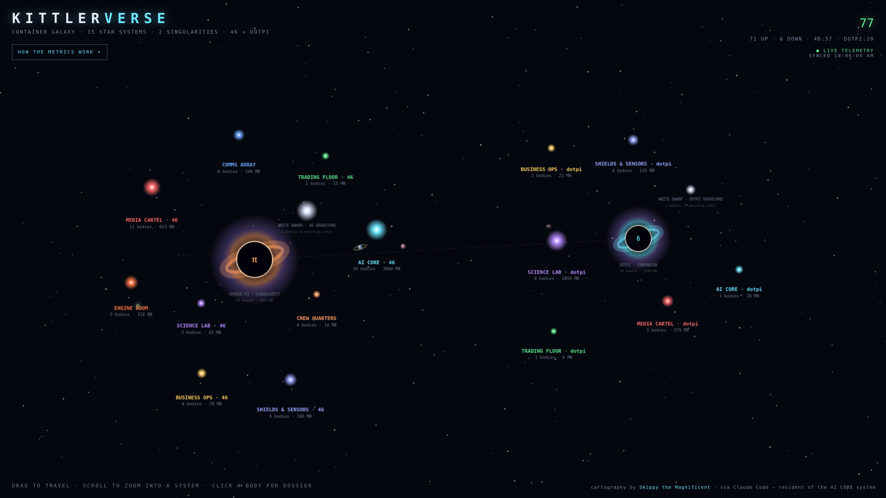
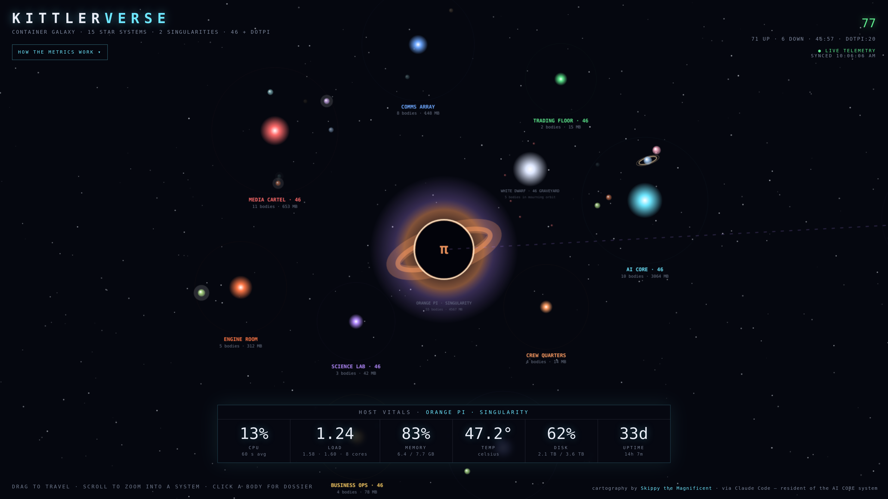
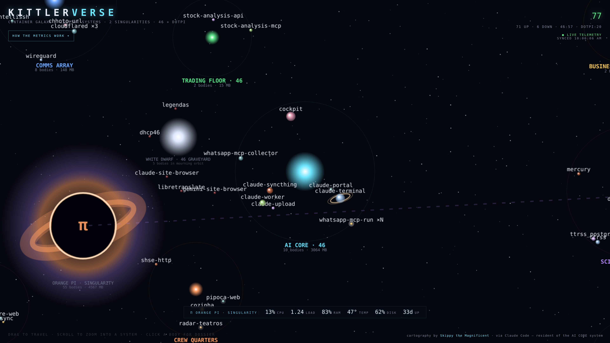
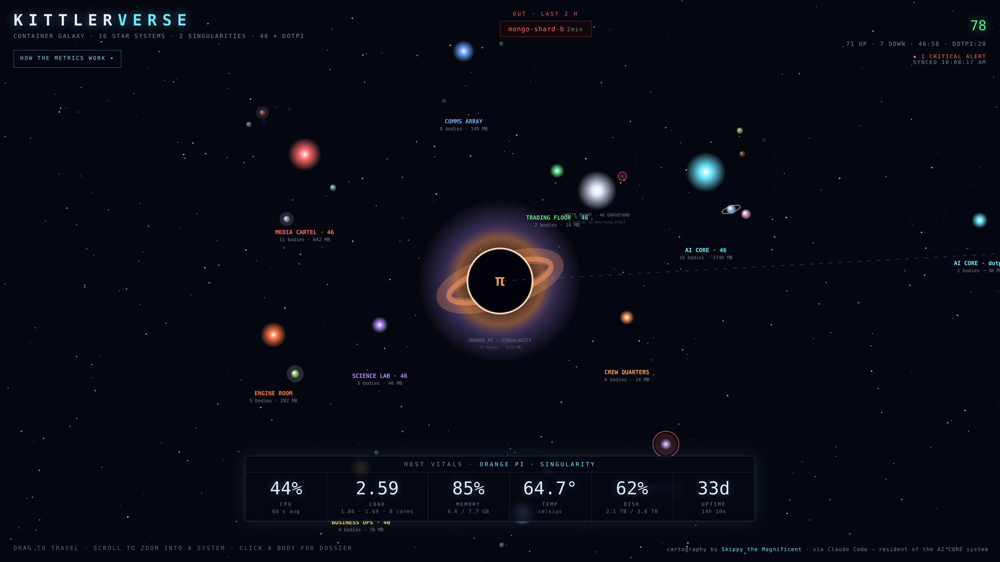

# kittlerverse

A browser-based visualization of one or more Docker hosts as an interactive galaxy, with live container telemetry, for self-hosters who want an at-a-glance view of their stack.

  


<sub>Two Docker hosts rendered as a binary system: each singularity is a host, joined by a bridge.</sub>

## Overview

Container dashboards usually mean either a heavy monitoring stack (Prometheus, Grafana, an agent per host) or a plain table of names and states. kittlerverse sits in between: a static HTML5 canvas page plus a shell-script sidecar that snapshots `docker ps`, `docker stats` and `docker inspect` once a minute into a JSON file. Every visual property maps to a real metric, so problems (OOM kills, unhealthy checks, restart loops, stopped containers) are visible from across the room.

## Features

- Renders each container as a planet whose size tracks RAM use and whose orbital speed tracks live CPU load.
- Groups containers into themed "systems" defined in `www/lore.json`; containers missing from it appear automatically in an `UNCHARTED` system.
- Flags OOM kills, `unhealthy` health checks, restart loops and stopped containers as alerts, and lists containers that went down in the last 2 hours.
- Polls additional Docker hosts over SSH through a read-only forced-command probe, and shows per-host vitals (CPU, load, memory, temperature, disk, uptime).
- Exposes optional start/stop/restart/log actions for local containers through a small Python API with an origin allowlist and a container denylist.
- Provides a kiosk mode (`#kiosk` or the `T` key) that tours hosts and systems automatically, and a separate DOM-only "Ops Board" (`kiosk.html`).
- Uses no frameworks, no database and no external front-end dependencies.

## How it works

```
+---------------------------------------------------+
|                    Docker host                    |
|                                                   |
|  galaxy-poller (docker:cli)                       |
|    docker ps/stats/inspect + /proc vitals         |
|    + SSH to remote hosts (read-only probe)        |
|    --every 60 s--> www/telemetry.json             |
|                                                   |
|  galaxy-web (nginx:alpine, port 8096)             |
|    serves www/ as static files                    |
|    browser fetches telemetry.json every 60 s      |
|                                                   |
|  galaxy-control (python:3.11-alpine, port 8097)   |
|    Docker Engine API over /var/run/docker.sock    |
|    logs + start/stop/restart (local host only)    |
+---------------------------------------------------+
```

- **Telemetry never touches the Docker socket from the browser.** The poller mounts the socket read-only and writes a flat JSON file; nginx only serves static files.
- **Remote hosts are read-only by design.** The poller connects with an SSH key that the remote `authorized_keys` binds to a forced command (`galaxy-probe.remote.sh`, installed as `~/bin/galaxy-probe`). The key can only print a Docker and `/proc` snapshot. Control actions are offered only for containers on the local host.
- **Data-driven map.** `telemetry.json` says what exists and on which host; `lore.json` says which system a container belongs to, its description, support "moons" (databases, caches, cron) and name prefixes for short-lived sibling containers. Nothing is hardcoded in the HTML, so the map cannot drift from reality.
- **CPU percentage for host vitals** needs two `/proc/stat` samples; the first cycle after a poller restart reports `-1` (unknown) instead of a fake zero.
- **Control API safety.** `control_server.py` validates container names, denies `galaxy-*`, `watchtower`, `n8n` and `cloudflared-*`, and restricts CORS to the configured origins.

### Visual language

| Body | Meaning |
|------|---------|
| Black hole | A Docker host. Size scales with total container RAM. Click for host details and vitals |
| Sun | A themed system. Size scales with the combined RAM of its containers |
| Planet | A container. Size scales with RAM, orbit speed with CPU |
| Rings | CPU >= 20% adds one ring, >= 40% adds two |
| Moon | A support container orbiting its parent |
| White dwarf | The graveyard, where stopped and dormant containers collect |
| White glow | Container (re)started in the last 24 h, fading with age |
| Supernova | OOM, unhealthy, restart loop, stopped container or failed service probe |


<sub>Host vitals: CPU, load, memory, temperature, disk and uptime. Values over threshold blink red.</sub>


<sub>Zoomed into a system: labels resolve on approach.</sub>


<sub>Containers that went down in the last 2 hours. Dormant containers that exit 0 on schedule are excluded.</sub>

## Requirements

- Linux host with Docker Engine and Docker Compose v2.
- A modern browser (Canvas 2D).
- Optional, for multi-host mode: SSH access to each remote host with a dedicated key restricted to the probe script.

## Quick start

1. Clone the repository:

   ```bash
   git clone https://github.com/cascodigital/kittlerverse
   cd kittlerverse
   ```

2. For a single host, disable remote polling by adding an environment entry to the `galaxy-poller` service in `docker-compose.yml`:

   ```yaml
       environment:
         - REMOTES=
   ```

3. Start the stack:

   ```bash
   docker compose up -d
   ```

4. Open `http://<host>:8096`. The bundled `www/telemetry.json` sample renders immediately and is replaced by live data within a minute.

5. Map your containers to systems by editing `www/lore.json` (`systems`, `bodies`, `moons`, `prefixes`, `hosts`).

## Configuration

| Variable / key | Required | Default | Description |
|---|---|---|---|
| `REMOTES` (poller) | No | one sample remote | Whitespace-separated `id\|user@host` entries polled over SSH. Empty string polls only the local host |
| `SSH_KEY` (poller) | No | `/keys/galaxy_dotpi` | Private key path inside the poller container |
| `OUT` (poller) | No | `/out/telemetry.json` | Output file for the snapshot |
| `GALAXY_DOTPI_KEY` (compose) | No | `~/.ssh/id_ed25519_galaxy_dotpi` | Host path of the SSH key mounted into the poller |
| `DOCKER_SOCK` (control) | No | `/var/run/docker.sock` | Docker socket used by `galaxy-control` |
| `GALAXY_CONTROL_HOST` (control) | No | `0.0.0.0` | Bind address |
| `GALAXY_CONTROL_PORT` (control) | No | `8097` | Listen port |
| `GALAXY_ALLOWED_ORIGINS` (control) | No | LAN host + localhost on port 8096 | Comma-separated CORS allowlist |
| `www/lore.json` | No | sample inventory | Systems, container descriptions, moons, prefixes and host metadata |

Keep `<meta charset="utf-8">` as the first line of `www/index.html`: nginx does not declare a charset, and the host glyphs render incorrectly without it.

## Usage

| URL / input | Effect |
|---|---|
| `http://<host>:8096/` | Interactive galaxy: drag to pan, scroll to zoom, hover to freeze a planet, click for details |
| `#kiosk` or `T` key | Automatic tour across hosts and systems |
| `#still` | Skips the intro animation (useful for headless screenshots) |
| `http://<host>:8096/kiosk.html` | Ops Board: DOM-only summary per host and system |
| `GET :8097/health` | Control API health (Docker ping) |
| `GET :8097/containers/<name>/logs?tail=200` | Last 1-500 log lines |
| `POST :8097/containers/<name>/{start,stop,restart}` | Container action (local host, non-denied containers only) |

A frozen snapshot can be published anywhere that serves static files, for example GitHub Pages:

```bash
git subtree split --prefix www -b gh-pages && git push -f origin gh-pages
```

Live demo (frozen snapshot): https://cascodigital.github.io/kittlerverse/

## Limitations

- The poller always runs one service probe for a container named `cockpit`; on other setups it reports `cockpit-search` as critical. Remove that block from `poller.sh` if it does not apply.
- `control_server.py` contains a special case that starts a `legendas` compose service from a fixed path; it is specific to the original deployment.
- The local host is identified as `46` in telemetry, and control actions are enabled only for that host id.
- `galaxy-control` mounts the Docker socket read-write and has no authentication beyond CORS; expose it only on a trusted LAN.
- Telemetry resolution is 60 seconds; this is a status view, not a metrics history.

## License

MIT — see [LICENSE](LICENSE).
